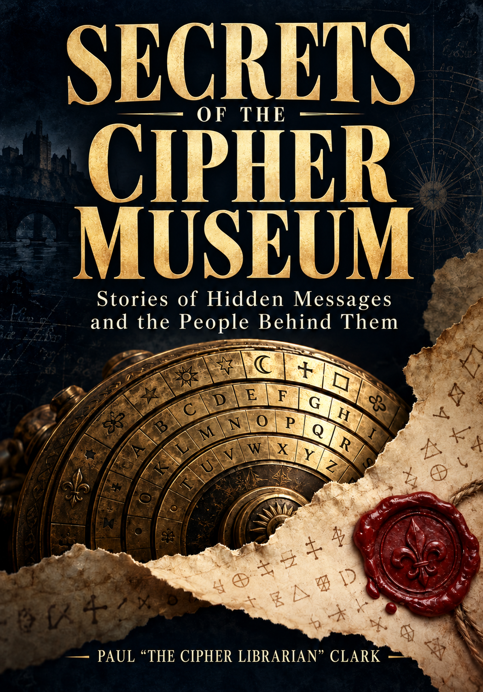

# 🏛️ The Cipher Museum

> *"The heart of the discerning acquires knowledge, for the ears of the wise seek it out."* — Proverbs 18:15

> *"So whether you eat or drink or whatever you do, do it all for the glory of God."* — 1 Corinthians 10:31 (NIV)

Exploring 3,900+ years of encryption, cryptanalysis, and hidden history.

The Cipher Museum is part digital exhibit, part cipher playground, and part codebreaking classroom exploring **3,900+ years** of encryption, cryptanalysis, and hidden history across **<!-- count:total -->172<!-- /count --> exhibits** — <!-- count:cipherHistory -->152<!-- /count --> cipher and history exhibits in **13 exhibit halls**, the <!-- count:foundations -->17<!-- /count -->-exhibit **Hall of Foundations** mathematics annex (§141–157), and <!-- count:protocols -->3<!-- /count --> **protocol and construction exhibits** (§158–160: ECDSA, Shamir's Secret Sharing, Zero-Knowledge Proofs). Modern cryptography uses more than ciphers — secure systems combine key exchange, encryption, hashing, signatures, secret sharing, and proofs.

**[Live Museum →](https://ciphermuseum.com)**

**[Independent audit reading pack — 216-page snapshot](audit/README.md)** — the frozen 30 October 2026 export includes page text, examples, source notes, supporting scripts/data, and an AI review prompt. Available as one document or smaller parts. Its source commit and limits are recorded in the pack; it does not update automatically with the live museum.

[](https://doi.org/10.5281/zenodo.23298940)
[](https://doi.org/10.5281/zenodo.23297920)

The live museum, software source archive, and research dataset are distinct:

- **Live museum:** the continuously deployed website at [ciphermuseum.com](https://ciphermuseum.com).
- **Software archive:** [`v1.0.0`](https://doi.org/10.5281/zenodo.23298941) is the initial GitHub/Zenodo software release. Its version DOI is `10.5281/zenodo.23298941`; its concept DOI for the evolving software is `10.5281/zenodo.23298940`. Neither is a dataset DOI.
- **Dataset archive:** [Cipher Corpus v0.6](https://doi.org/10.5281/zenodo.23297920) is already published separately. Use its version DOI when citing the 100,326-record dataset.

The root [`CITATION.cff`](CITATION.cff) describes Cipher Museum software. Corpus
citation and rights information remains in [`public/corpus/README.md`](public/corpus/README.md).

---

## 📚 Forthcoming Book

<a href="https://ciphermuseum.com/the-book.html"></a>

**[Secrets of the Cipher Museum](https://ciphermuseum.com/the-book.html)**

*Stories of Hidden Messages and the People Behind Them* · Paul “The Cipher Librarian” Clark

Twenty true investigations into hidden messages, contested evidence, and the consequences of knowing—with an interactive museum where you can follow the clues yourself. The opening follows the identification and verification of Mary Stuart’s recovered letters, published in 2023. Chapter links and QR codes offer specific evidence questions to explore in the free museum; the historical narrative stands on its own. Read the new prologue excerpt and reading-group questions on the companion page. Publication details are forthcoming.

**[Read the opening →](https://ciphermuseum.com/the-book.html#sample)** · **[Try The Curator’s Sealed Letter →](https://ciphermuseum.com/sealed-letter.html)**

The companion mystery can be started directly online or opened with the book's four original puzzles. Readers decode a dispatch, compare conflicting copies, request a fifth source, and submit a finding that separates evidence from accusation. Progressive hints, an answer reveal, restart, and optional clipboard-only playtest notes support the first reader trial; see the [pilot plan](docs/reader-mystery-pilot.md). It is free and requires no account or purchase. The cover and book excerpt retain their separate copyright; see [License](#-license).

---

## 📰 Recent Changes

README reviewed against `main` on **31 October 2026**. These changes are already merged:

- **30 October — Book preview and homepage feature.** Added the forthcoming book’s cover, opening excerpt, reading-group questions, and [Curator’s Sealed Letter](https://ciphermuseum.com/sealed-letter.html) companion. The homepage now features the book directly below its introduction. ([#16](https://github.com/systemslibrarian/cipher-museum/pull/16), [#17](https://github.com/systemslibrarian/cipher-museum/pull/17))
- **30 October — Full-paper research follow-up.** Repaired numerical-boundary certainty, saved investigation context, symbol-inventory history, image overlays, and duplicate-reference handling. Added exact finite OTP experiments and scoped lessons on secrecy, authenticity, hardware leakage, quantum resources, and elliptic-curve formulas. The work does not claim reliable general decipherment or reproduce the papers’ hardware experiments. See the [implementation record and limits](docs/RESEARCH_REVIEW_2026-10-30.md). ([#15](https://github.com/systemslibrarian/cipher-museum/pull/15))
- **29 October — Evidence-led research tools.** Added a multi-image reading desk, revisable symbol inventory, resumable investigation bundles, hypothesis register, bounded numerical segmentation, historical French/Italian/Latin scoring profiles, and a beam-search comparison. Expanded GPRS and UA-8295 evidence from the full papers. Both homophonic solvers still achieved **0 exact recoveries out of 39** in the published small-budget comparison; known-key application is a separate task. See [the review](docs/RESEARCH_REVIEW_2026-10-29.md) and [evaluation v2](data/research/v2/README.md). ([#14](https://github.com/systemslibrarian/cipher-museum/pull/14))
- **26 October — Book-supported teaching and solver experiments.** Implemented [21 ebook-backed improvements](audit/EBOOK_IMPLEMENTATION_PROGRESS.md), including Lorenz chronology and operation, entropy, freshness, encoding, KDFs, lattice mechanisms, and implementation leakage. Added a synthetic Colossus chi-setting exercise, seeded columnar search, and a [reproducible classroom worksheet](public/teaching/columnar-classroom.md). The [solver evaluation](docs/SOLVER_EVALUATION.md) retains failures and does not establish a universal solver ranking. ([#12](https://github.com/systemslibrarian/cipher-museum/pull/12))
- **26 October — Whole-museum accuracy review.** Completed a reading and consistency pass across the then-current **214 public HTML pages**, with targeted source checks and corrections to historical claims, teaching models, examples, navigation, and input handling. This was not independent verification of every fact. See the [completed tracker](docs/ACCURACY_REVIEW_PROGRESS.md) and [page-by-page record](docs/PAGE_BY_PAGE_ACCURACY_AUDIT.md). The later book pages bring the audit export to **216 pages**. ([#13](https://github.com/systemslibrarian/cipher-museum/pull/13))
- **25 October — Research investigations and modern case studies.** Added the [Evidence Workbench](https://ciphermuseum.com/lab/evidence-workbench.html), [historical investigations](https://ciphermuseum.com/lab/decipherment-cases.html), [modern attack evidence](https://ciphermuseum.com/lab/modern-attack-evidence.html), and exhibits on [UA-8295](https://ciphermuseum.com/ciphers/ua-8295.html), [SoDark](https://ciphermuseum.com/ciphers/sodark.html), and [NFC deployment](https://ciphermuseum.com/ciphers/nfc-deployment.html). See the [research-paper implementation checklist](docs/PAPER_REVIEW_IMPLEMENTATION.md).

Earlier work includes the [corrected Cipher Corpus v0.8](docs/releases/corpus-v0.8.md), [manual-cipher procedures](docs/HISTORICAL_PROCEDURES.md), [book-guided codebreaking exercises](docs/BOOK_REVIEW_IMPROVEMENTS.md), and [engine verification standard](docs/CIPHER_ENGINE_STANDARD.md). The published v0.6 dataset archive and software release DOIs remain distinct from the evolving website.

April 2026: Cipher Museum listed in Crypto Museum’s (cryptomuseum.com) curated Virtual Museums directory, alongside Cipher History Museum, Jerry Proc’s Crypto Pages, and other established crypto-history archives.

---

## ✨ Features

### 🗺️ Thirteen Exhibit Halls · <!-- count:cipherHistory -->152<!-- /count --> Cipher & History Exhibits · The Foundations Annex

Beyond the 13 cipher halls below, the **[Hall of Foundations](https://ciphermuseum.com/hall-of-foundations/index.html)** annex (§141–157) exhibits the mathematics under the cryptography — from modular arithmetic to lattices and pairings — and three **modern-protocol exhibits** (§158–160: ECDSA, Shamir's Secret Sharing, Zero-Knowledge Proofs) extend Hall XI beyond ciphers.

| Hall | Title | Exhibits |
|------|-------|---------|
| [I](https://ciphermuseum.com/halls/ancient.html) | World Origins of Cryptography | [Egyptian Substitution](https://ciphermuseum.com/ciphers/egyptian-substitution.html), [Rosetta Stone](https://ciphermuseum.com/ciphers/rosetta-stone.html), [Histiaeus's Tattoo](https://ciphermuseum.com/ciphers/histiaeus-tattoo.html), [Scytale](https://ciphermuseum.com/ciphers/scytale.html), [Aeneas Tacticus](https://ciphermuseum.com/ciphers/aeneas-tacticus.html), [Caesar](https://ciphermuseum.com/ciphers/caesar.html), [Atbash](https://ciphermuseum.com/ciphers/atbash.html), [Kama Sutra](https://ciphermuseum.com/ciphers/kama-sutra.html), [Polybius](https://ciphermuseum.com/ciphers/polybius.html), [Arabic Nomenclators](https://ciphermuseum.com/ciphers/arabic-nomenclators.html), [ROT13](https://ciphermuseum.com/ciphers/rot13.html) |
| [II](https://ciphermuseum.com/halls/substitution.html) | Classical Substitution | [Monoalphabetic](https://ciphermuseum.com/ciphers/monoalphabetic.html), [Nomenclator](https://ciphermuseum.com/ciphers/nomenclator.html), [Babington](https://ciphermuseum.com/ciphers/babington.html), [Homophonic](https://ciphermuseum.com/ciphers/homophonic.html), [Great Cipher](https://ciphermuseum.com/ciphers/great-cipher.html), [Playfair](https://ciphermuseum.com/ciphers/playfair.html), [Four-Square](https://ciphermuseum.com/ciphers/four-square.html), [Two-Square](https://ciphermuseum.com/ciphers/two-square.html), [Hill](https://ciphermuseum.com/ciphers/hill.html), [German Double Playfair](https://ciphermuseum.com/ciphers/double-playfair.html) |
| [III](https://ciphermuseum.com/halls/polyalphabetic.html) | Polyalphabetic Revolution | [Alberti Disk](https://ciphermuseum.com/ciphers/alberti-disk.html), [Vigenère](https://ciphermuseum.com/ciphers/vigenere.html), [Porta](https://ciphermuseum.com/ciphers/porta.html), [Gronsfeld](https://ciphermuseum.com/ciphers/gronsfeld.html), [Beaufort](https://ciphermuseum.com/ciphers/beaufort.html), [Running Key](https://ciphermuseum.com/ciphers/running-key.html), [Autokey](https://ciphermuseum.com/ciphers/autokey.html) |
| [IV](https://ciphermuseum.com/halls/transposition.html) | Transposition & Fractionation | [Rail Fence](https://ciphermuseum.com/ciphers/rail-fence.html), [Columnar](https://ciphermuseum.com/ciphers/columnar.html), [Double Transposition](https://ciphermuseum.com/ciphers/double-transposition.html), [Bifid](https://ciphermuseum.com/ciphers/bifid.html), [Trifid](https://ciphermuseum.com/ciphers/trifid.html), [ADFGX](https://ciphermuseum.com/ciphers/adfgx.html), [ADFGVX](https://ciphermuseum.com/ciphers/adfgvx.html), [Fractionated Morse](https://ciphermuseum.com/ciphers/fractionated-morse.html), [Fleissner Turning Grille](https://ciphermuseum.com/ciphers/turning-grille.html), [Myszkowski](https://ciphermuseum.com/ciphers/myszkowski.html), [RS44](https://ciphermuseum.com/ciphers/rs44.html), [AMSCO](https://ciphermuseum.com/ciphers/amsco.html) |
| [V](https://ciphermuseum.com/halls/military.html) | Military & Spy Ciphers | [Nihilist](https://ciphermuseum.com/ciphers/nihilist.html), [Bazeries](https://ciphermuseum.com/ciphers/bazeries.html), [VIC](https://ciphermuseum.com/ciphers/vic.html), [Straddling Checkerboard](https://ciphermuseum.com/ciphers/straddling-checkerboard.html), [Book Cipher](https://ciphermuseum.com/ciphers/book-cipher.html) |
| [VI](https://ciphermuseum.com/halls/civil-war.html) | Civil War Gallery | [Stager](https://ciphermuseum.com/ciphers/stager.html), [Confederate Vigenère](https://ciphermuseum.com/ciphers/confederate-vigenere.html), [Dictionary Code](https://ciphermuseum.com/ciphers/dictionary-code.html) |
| [VII](https://ciphermuseum.com/halls/machines.html) | Mechanical Cipher Machines | [Jefferson Disk](https://ciphermuseum.com/ciphers/jefferson-disk.html), [Wadsworth Cipher](https://ciphermuseum.com/ciphers/wadsworth-cipher.html), [Chaocipher](https://ciphermuseum.com/ciphers/chaocipher.html), [Enigma](https://ciphermuseum.com/ciphers/enigma.html), [M-209](https://ciphermuseum.com/ciphers/m209.html), [Lorenz](https://ciphermuseum.com/ciphers/lorenz.html), [Purple](https://ciphermuseum.com/ciphers/purple.html), [SIGABA](https://ciphermuseum.com/ciphers/sigaba.html), [Typex](https://ciphermuseum.com/ciphers/typex.html), [Navajo Code Talkers](https://ciphermuseum.com/ciphers/navajo-code-talkers.html), [NEMA](https://ciphermuseum.com/ciphers/nema.html), [Hagelin C-36 / C-52](https://ciphermuseum.com/ciphers/hagelin-c36.html) |
| [VIII](https://ciphermuseum.com/halls/puzzle.html) | Puzzle & Novelty Ciphers | [Pigpen](https://ciphermuseum.com/ciphers/pigpen.html), [Bacon](https://ciphermuseum.com/ciphers/bacon.html), [Tap Code](https://ciphermuseum.com/ciphers/tap-code.html), [Copiale](https://ciphermuseum.com/ciphers/copiale.html), [Beale](https://ciphermuseum.com/ciphers/beale.html), [Voynich](https://ciphermuseum.com/ciphers/voynich.html), [Dorabella](https://ciphermuseum.com/ciphers/dorabella.html), [Zodiac](https://ciphermuseum.com/ciphers/zodiac.html), [Kryptos](https://ciphermuseum.com/ciphers/kryptos.html) |
| [IX](https://ciphermuseum.com/halls/unbreakable.html) | The Unbreakable | [One-Time Pad](https://ciphermuseum.com/ciphers/one-time-pad.html), [Vernam](https://ciphermuseum.com/ciphers/vernam.html), [VENONA](https://ciphermuseum.com/ciphers/venona.html), [Solitaire / Pontifex](https://ciphermuseum.com/ciphers/solitaire.html) |
| [X](https://ciphermuseum.com/halls/codebreakers.html) | Hall of Codebreakers | [Cabinet Noir](https://ciphermuseum.com/ciphers/cabinet-noir.html), [Station HYPO](https://ciphermuseum.com/ciphers/station-hypo.html), [Bletchley Park](https://ciphermuseum.com/ciphers/bletchley-park.html), [Joseph Rochefort](https://ciphermuseum.com/ciphers/rochefort.html), [Arne Beurling](https://ciphermuseum.com/ciphers/beurling.html), [Dilly Knox](https://ciphermuseum.com/ciphers/dilly-knox.html), [Herbert Yardley](https://ciphermuseum.com/ciphers/yardley.html), [Mavis Batey](https://ciphermuseum.com/ciphers/mavis-batey.html), [GCHQ Trio](https://ciphermuseum.com/ciphers/gchq-trio.html), [David Kahn](https://ciphermuseum.com/ciphers/kahn.html), [Elonka Dunin](https://ciphermuseum.com/ciphers/dunin.html), [George Lasry](https://ciphermuseum.com/ciphers/lasry.html), [Agnes Driscoll](https://ciphermuseum.com/ciphers/agnes-driscoll.html), [Bill Tutte](https://ciphermuseum.com/ciphers/bill-tutte.html), [Elizebeth Friedman](https://ciphermuseum.com/ciphers/elizebeth-friedman.html), [Joan Clarke](https://ciphermuseum.com/ciphers/joan-clarke.html), [Leo Marks](https://ciphermuseum.com/ciphers/leo-marks.html), [Mary Stuart Castelnau Letters](https://ciphermuseum.com/ciphers/mary-stuart-castelnau-letters.html), [Bombe](https://ciphermuseum.com/ciphers/bombe.html), [Colossus](https://ciphermuseum.com/ciphers/colossus.html) |
| [XI](https://ciphermuseum.com/halls/modern-crypto.html) | Modern Cryptography | [DES](https://ciphermuseum.com/ciphers/des.html), [Diffie-Hellman](https://ciphermuseum.com/ciphers/diffie-hellman.html), [RSA](https://ciphermuseum.com/ciphers/rsa.html), [AES](https://ciphermuseum.com/ciphers/aes.html), [SHA-256](https://ciphermuseum.com/ciphers/sha256.html), [ECDSA](https://ciphermuseum.com/ciphers/ecdsa.html) (§158), [Shamir's Secret Sharing](https://ciphermuseum.com/ciphers/shamir-secret-sharing.html) (§159), [Zero-Knowledge Proofs](https://ciphermuseum.com/ciphers/zero-knowledge-proofs.html) (§160), [UA-8295](https://ciphermuseum.com/ciphers/ua-8295.html), [SoDark](https://ciphermuseum.com/ciphers/sodark.html), [NFC Deployment](https://ciphermuseum.com/ciphers/nfc-deployment.html) |
| [XII](https://ciphermuseum.com/halls/unsolved.html) | Unsolved Ciphers | [Voynich](https://ciphermuseum.com/ciphers/voynich.html), [Kryptos](https://ciphermuseum.com/ciphers/kryptos.html), [Beale](https://ciphermuseum.com/ciphers/beale.html), [Dorabella](https://ciphermuseum.com/ciphers/dorabella.html), [Zodiac Z-13/Z-32](https://ciphermuseum.com/ciphers/zodiac.html), [Phaistos Disc](https://ciphermuseum.com/ciphers/phaistos-disc.html), [Shugborough](https://ciphermuseum.com/ciphers/shugborough.html), [D'Agapeyeff](https://ciphermuseum.com/ciphers/dagapeyeff.html), [Somerton Man](https://ciphermuseum.com/ciphers/somerton-man.html), [McCormick](https://ciphermuseum.com/ciphers/mccormick.html) |
| [XIII](https://ciphermuseum.com/halls/culture.html) | Cipher Culture | [Bach's BACH motif](https://ciphermuseum.com/ciphers/bach-motif.html), [Conan Doyle's Dancing Men](https://ciphermuseum.com/ciphers/dancing-men.html), [Poe's Gold-Bug](https://ciphermuseum.com/ciphers/gold-bug.html), [Cicada 3301](https://ciphermuseum.com/ciphers/cicada-3301.html), [Krypto ARG](https://ciphermuseum.com/ciphers/krypto-arg.html), [MIT Mystery Hunt](https://ciphermuseum.com/ciphers/mit-mystery-hunt.html), [Sator Square](https://ciphermuseum.com/ciphers/sator-square.html), [Freemason pigpen tradition](https://ciphermuseum.com/ciphers/freemason-pigpen.html), [Da Vinci Code](https://ciphermuseum.com/ciphers/da-vinci-code.html), [National Treasure](https://ciphermuseum.com/ciphers/national-treasure.html), [Gravity Falls](https://ciphermuseum.com/ciphers/gravity-falls.html), [Field Hollers](https://ciphermuseum.com/ciphers/field-hollers.html) |

### 🔐 Exhibit Structure

1. **Historical Context** — When, where, who used it, why
2. **How It Works** — Encryption steps, diagrams, interactive demo
3. **How It Was Broken** — The specific technique, with context
4. **What It Teaches Modern Crypto** — Relevant concepts, with analogies distinguished from historical descent

### 🎯 <!-- count:engines -->88<!-- /count --> Registered Engines · <!-- count:interactiveExhibits -->147<!-- /count --> Interactive Exhibits

The registry contains **<!-- count:engines -->88<!-- /count --> engines**. **<!-- count:interactiveExhibits -->147<!-- /count --> exhibits** have an on-page working demo or controllable visualization, including **<!-- count:interactiveCipherHistory -->127<!-- /count --> cipher and history exhibits**. These counts measure different things: visualizations and mathematical interactives need not be reversible ciphers. See [collection count definitions](docs/COLLECTION_COUNTS.md).

Type a message, set a key, and watch the cipher work in real time. Demos are dynamically generated by [js/demo-loader.js](js/demo-loader.js) from the engine implementations in [js/ciphers/all-engines.js](js/ciphers/all-engines.js), and the same engines power the [Codebreaker's Workbench](https://ciphermuseum.com/lab/workbench.html).

For a sortable, filterable selection of exhibits (era, type, security, hall, solved status, key method) see the [Cipher Comparison Table](https://ciphermuseum.com/comparison.html). For the full <!-- count:cipherHistory -->152<!-- /count -->-exhibit roster including biographies and context pages, see the [Museum Map](https://ciphermuseum.com/museum-map.html).

### 📊 Additional Tools

- **[Cipher Corpus](https://ciphermuseum.com/cipher-corpus.html)** — A library of synthetic challenges and historically themed exercises for classical cryptanalysis. The current v0.8 download has 100,313 records across 85 cipher types; the published v0.6 archive has 100,326. Includes:
    - **Corrected v0.8 download**: the complete canonical dataset as compressed JSONL, with corrected Two-square pairs, five unsupported citations identified as errata, and v0.7's historical-pair and metadata corrections. [Download and read the change notes](https://ciphermuseum.com/cipher-corpus.html#corrected-corpus). The separately published v0.6 archive keeps its own DOI; v0.8 has no Zenodo DOI.
    - **Challenge Mode** for learners: hides solutions for ciphertext-only practice.
    - **Known Corpus Mode** for teaching, benchmarking, and tool-building: shows all metadata, keys, and plaintexts.
    - **Versioned exports**: the on-page browser, historical supplement and three-shot evaluation export use corrected v0.8 records. The older JSON, CSV, difficulty, multilingual and noisy exports remain labeled v0.6; its canonical set covers 9 languages, while v0.8 covers 7.
    - **Quality rules**: Each v0.8 browser card states pair verification and provenance status. Its canonical set contains **41 records labeled historical**. The corrected 87-record historical supplement overlaps 42 canonical IDs (41 historical and one reclassified synthetic Enigma exercise) and contains 45 additional entries that remain unverified and excluded from benchmarks. A documented citation and replay audit distinguishes contextual sources from authentic historical pairs. The original 100-record v0.6 supplement remains available as a labeled archive.
    - **Cryptanalysis tools**: `scripts/hill-climbing-solver.js` and `scripts/sa-solver.js` for automated monoalphabetic cipher breaking (quadgram scoring; [small-budget evaluation](docs/SOLVER_EVALUATION.md) reports the tested outcomes and limits).
    - **Integration**: Linked from main nav, mobile nav, and footer. Direct integration with Cipher Detective and Workbench.
    - **Accessibility**: Includes skip links, labeled controls and keyboard-navigation checks; this is not a complete WCAG conformance certification.
    - **For educators, learners, and tool builders**: Practice, teach, or benchmark cryptanalysis tools with reproducible, documented examples. Builds on foundational benchmark work by [CipherBank (Li et al., 2025)](https://arxiv.org/pdf/2504.19093).

- **[Codebreaker's Workbench](https://ciphermuseum.com/lab/workbench.html)** — A unified hands-on lab that exposes **all <!-- count:engines -->88<!-- /count --> cipher engines** behind one consistent interface. Pick any cipher from the dropdown, paste your text, set a key (or accept the default), and encrypt/decrypt instantly. Beyond the per-exhibit demos it adds:
    - **Frequency analyser** — letter-frequency histogram with Index of Coincidence and Chi-square against English, clues for comparing cipher hypotheses rather than identifying a system on their own.
    - **Kasiski / period detector** — repeated-trigram spacing analysis for breaking Vigenère-family ciphers.
    - **N-gram & entropy panel** — bigram/trigram counts and empirical Shannon entropy as descriptive evidence. A fixed bijective substitution relabels counts and preserves entropy, so this alone cannot distinguish it from transposition.
    - **Side-by-side Encrypt/Decrypt panes** with copy-to-clipboard and a swap button so you can iterate on a key without retyping ciphertext.
    - **Same engine source as the exhibits** — the workbench pulls from [js/ciphers/all-engines.js](js/ciphers/all-engines.js), so anything you reproduce here matches the shared-engine demos; bespoke exhibits may expose different settings and historical conventions.
- **[Cipher Detective](https://ciphermuseum.com/cipher-detective.html)** — Identify likely cipher families from IoC, chi-square, and Kasiski evidence; preserve source transcriptions and annotations; and work through one-to-one substitution hypotheses at a manual solving desk.
- **[Evidence Workbench](https://ciphermuseum.com/lab/evidence-workbench.html)** — Preserve source transcriptions, revisions, alternative readings, derived layers, and image-linked regions. Rotate/crop manuscript images, split or merge symbol classes with history, record hypotheses, and export/import investigation bundles that flag stale results.
    - **Bounded research tools** — known-key numerical segmentation with alternative paths and explicit pruning limits; experimental homophonic annealing and beam search with locked mappings, seeds, budgets, retained candidates, and historical language profiles that can abstain.
    - **Evidence is distinct from a readable candidate** — clean key application does not prove historical correctness; evaluation separates known-key application, unknown-key recovery, language/domain shift, segmentation, and wrong hypotheses. See [evaluation v1](data/research/v1/README.md) and [v2](data/research/v2/README.md).
- **[Historical Investigations](https://ciphermuseum.com/lab/decipherment-cases.html)** — Source-backed Copiale and Mary Stuart cases, plus a replay of the first Z340 section with its route and exceptions disclosed.
- **[Modern Attack Evidence](https://ciphermuseum.com/lab/modern-attack-evidence.html)** — Compare attack access, measurements, inferences, and open questions across published cases. The case studies describe their conditions and do not simulate an attack on real equipment.
- **[Teaching Resources](https://ciphermuseum.com/teaching.html)** — Classroom activities, book-to-exhibit reading trails, research tools, and the reader mystery, with simplified models and evidence limits stated.
- **[Site Search](https://ciphermuseum.com/search.html)** — Search across all <!-- count:total -->172<!-- /count --> exhibits (<!-- count:cipherHistory -->152<!-- /count --> cipher and history exhibits, the Hall of Foundations annex, and the modern-protocol exhibits), 13 exhibit halls, codebreaker biographies, cryptanalysis techniques, and the timeline. Index-driven, no backend, deep-link via `?q=`.
- **[Cryptanalysis Techniques](https://ciphermuseum.com/cryptanalysis.html)** — 10 explained approaches, with seven hands-on demonstrations: frequency analysis, Kasiski examination, index of coincidence, crib dragging, known-plaintext attack, hill climbing, simulated annealing, stepping-switch cryptanalysis (Purple), computer-assisted manuscript analysis (Copiale), and Chaocipher reconstruction.
- **[Cipher Challenges](https://ciphermuseum.com/challenges.html)** — 10 progressive puzzles from Caesar to Enigma with hints and solutions.
- **[Timeline](https://ciphermuseum.com/timeline.html)** — Interactive 3,900+-year history with era filtering, scroll-spy, and 50+ clickable exhibit events.
- **[Comparison Table](https://ciphermuseum.com/comparison.html)** — Sortable, filterable table comparing the museum collection by type, era, hall, security level, solved status, and key method.
- **[Cipher Flow Explorer](https://ciphermuseum.com/cipher-flow.html)** — Visual relationship map between cipher families.
- **[Museum Map](https://ciphermuseum.com/museum-map.html)** — Architectural floor plan with all exhibit halls and cipher exhibits.
- **[Guided Tours](https://ciphermuseum.com/tours/index.html)** — Structured learning paths through the collection.
- **[Glossary](https://ciphermuseum.com/glossary.html)** — Comprehensive cryptography term reference.
- **[Further Reading](https://ciphermuseum.com/further-reading.html)** — Books, journals, source index, and edition-specific chapter trails linking reading to museum exhibits and exercises.
- **[Community](https://ciphermuseum.com/community/index.html)** — Curated community examples plus a privacy-preserving local draft download for proposing corrections, write-ups, or challenges through GitHub Issues.

---

## 📖 Complete Cipher Index

All <!-- count:cipherHistory -->152<!-- /count --> cipher and history exhibits, alphabetically. Biographies and context pages are noted; plain text entries generally describe cipher systems. The 17 Hall of Foundations exhibits (§141–157) and the 3 modern-protocol exhibits (§158–160: ECDSA, Shamir's Secret Sharing, Zero-Knowledge Proofs) are listed separately above.


| Cipher | Era | Brief Description | How It Was Broken / Status |
|--------|-----|-------------------|----------------------------|
| [ADFGVX Cipher](https://ciphermuseum.com/ciphers/adfgvx.html) | WWI · June 1918 | ADFGVX combined a 6×6 substitution square with columnar transposition. Painvin’s June 1918 solutions exploited particular traffic and keys, not every later message automatically. | Painvin recovered keys from German traffic in June 1918. |
| [ADFGX Cipher](https://ciphermuseum.com/ciphers/adfgx.html) | WWI · March 1918 | Germany’s ADFGX field cipher appeared in March 1918; Painvin obtained solutions in April. Its square-plus-transposition construction required continuing key recovery. | Painvin and other Allied analysts used repeated traffic, statistics and transposition analysis in 1918. |
| [Aeneas Tacticus Water-Clock Signal Code](https://ciphermuseum.com/ciphers/aeneas-tacticus.html) | Classical Greece · ~350 BCE | Aeneas’s water-clock signaling, preserved in Polybius: synchronized vessels selected preset military messages, not letters of an alphabet. | Context or biography; not an encryption security rating. |
| [AES (Advanced Encryption Standard)](https://ciphermuseum.com/ciphers/aes.html) | Modern · 2001 | AES (2001) — the cipher that encrypts the modern world; chosen by open competition, scrutinised for two decades, still without a practical attack. | Security depends on the construction, parameters and correct use; see exhibit. |
| [Affine Cipher E(x) = a·x + b mod 26](https://ciphermuseum.com/ciphers/affine.html) | Antiquity → 1800s · math-age | The affine cipher — a single linear formula E(x)=a·x+b mod 26 that generalises Caesar (a=1) and Atbash (a=25, b=25). Just 312 keys; trivially broken. | Published attacks or structural weaknesses; see exhibit. |
| [Agnes Meyer Driscoll](https://ciphermuseum.com/ciphers/agnes-driscoll.html) | Interwar & WWII · USA | Agnes Meyer Driscoll helped develop U.S. naval cryptanalysis and trained later analysts. Her work included Japanese naval codes, early JN-25 and cipher-machine analysis. | Codebreaker Biography |
| [AMSCO](https://ciphermuseum.com/ciphers/amsco.html) | American Cryptogram Association specification | AMSCO from the American Cryptogram Association specification: alternate one-letter and two-letter cells, read keyed columns, and reconstruct an incomplete final row. | Variable-cell transposition preserves frequencies and is susceptible to probable-word and scored permutation search. |
| [Alberti Cipher Disk](https://ciphermuseum.com/ciphers/alberti-disk.html) | Renaissance · 1467 | Alberti’s fifteenth-century cipher disk illustrates changing substitutions using two alphabets. The exhibit distinguishes historical instructions from a regular-step teaching model. | Index of Coincidence · Frequency analysis |
| [Arabic Nomenclators](https://ciphermuseum.com/ciphers/arabic-nomenclators.html) | Abbasid Caliphate · ~850 CE | Arabic cryptanalytic scholarship and a teaching model of nomenclators: frequency analysis, codewords, and the need to identify a particular historical key. | Broken (by its own inventors) |
| [ARG Ciphers](https://ciphermuseum.com/ciphers/krypto-arg.html) | Web 2.0 · 2001–present | Alternate-reality games — from The Beast (2001) to Year Zero (2007) and beyond — built on the assumption that players will recognise, transcribe, and crack classical ciphers across forums, phone calls, and physical artifacts. | Promotional / collaborative cipher hunts |
| [Argenti Family Cipher Vatican papal nomenclators · 1500s–1600s](https://ciphermuseum.com/ciphers/argenti.html) | Renaissance Italy · 1500s–1600s | Matteo and Marcello Argenti served as papal cryptanalysts to seven popes. Their Trattato in Cifra codified the homophonic-nomenclator pattern that dominated European diplomacy for two centuries. | Published attacks or structural weaknesses; see exhibit. |
| [Arne Beurling](https://ciphermuseum.com/ciphers/beurling.html) | WWII · Sweden | Arne Beurling’s 1940 reconstruction of the Siemens T52, with assistance and subsequent daily-key recovery distinguished from the initial breakthrough. | Codebreaker Biography |
| [Arnold–André Book Cipher Blackstone’s Commentaries · 1779–1780](https://ciphermuseum.com/ciphers/arnold-andre.html) | American Revolution · 1779–1780 | The book cipher Benedict Arnold and Major John André used to plot the surrender of West Point. Each plaintext word located in a shared book (Blackstone’s <em>Commentaries</em>) and transmitted as the triple page.line.word. | Compromised by capture (1780) |
| [Atbash](https://ciphermuseum.com/ciphers/atbash.html) | Ancient · ~500 BC | Atbash — the ancient Hebrew reflection cipher (A<->Z, B<->Y, C<->X), self-inverse and used in the Book of Jeremiah (25:26, 51:41) for SHESHACH. | Inspection (it is its own inverse) |
| [Autokey](https://ciphermuseum.com/ciphers/autokey.html) | Renaissance · 1586 | Plaintext autokey extends a primer with message letters. It removes a fixed repeating keyword but retains exploitable language structure and error propagation. | Crib propagation and language-scored searches; ordinary repeating-key Kasiski analysis does not apply directly. |
| [The Babington Plot Cipher](https://ciphermuseum.com/ciphers/babington.html) | Elizabethan · 1586 | The 1586 Babington Plot: intercepted nomenclator letters, a forged postscript, and the difference between compromised keys and an insecure transport channel. | Thomas Phelippes, working for Sir Francis Walsingham · within days of interception |
| [Bach's B-A-C-H Motif](https://ciphermuseum.com/ciphers/bach-motif.html) | Baroque Germany · 1750 | The four notes B♭ – A – C – B♮ spell 'BACH' in German musical notation — a self-signature Bach embedded in his final unfinished fugue. | Musical cryptogram |
| [Bacon's Cipher](https://ciphermuseum.com/ciphers/bacon.html) | 1605 | Bacon’s biliteral alphabet represents letters with patterns of two forms and can hide them in a carrier. Binary representation is distinct from a direct historical origin for ASCII. | Pattern recognition · Statistical analysis of A/B distribution |
| [Bazeries Cipher](https://ciphermuseum.com/ciphers/bazeries.html) | 1890s · France | Bazeries cylinder cipher — Etienne Bazeries' 1891 wheel cipher with 20 alphabet disks, an evolution later adopted by the US Army as the M-94 in 1922. | Layered frequency analysis |
| [Beale Ciphers](https://ciphermuseum.com/ciphers/beale.html) | 19th Century · published 1885 | Beale ciphers — three numerical ciphers published in an 1885 Lynchburg pamphlet, said to have been written in the 1820s and to point to a Virginia treasure. Only #2 was solved (Declaration of Independence key); #1 and #3 unsolved. | Unsolved (Beale 1 & 3) |
| [Beaufort Cipher](https://ciphermuseum.com/ciphers/beaufort.html) | Victorian · 1857 | Beaufort cipher (1857) — Sir Francis Beaufort's reciprocal Vigenère variant where encrypt and decrypt are the same operation. Broken by Kasiski examination. | Kasiski Examination · Index of Coincidence |
| [Bible Code — Equidistant Letter Sequences](https://ciphermuseum.com/ciphers/bible-code.html) | 1994 · Refuted 1999 | The Bible Code — equidistant letter sequences (ELS) claimed to hide prophecies in the Hebrew scriptures. A rigorous statistical refutation by McKay et al. (1999) showed the same method finds identical 'predictions' in War and Peace and Moby-Dick. | Statistical claims challenged by controlled counterexamples and analysis of selection flexibility. |
| [Bifid Cipher](https://ciphermuseum.com/ciphers/bifid.html) | 1901 | Bifid cipher (1901) — Felix Delastelle's fractionation cipher that splits Polybius coordinates, transposes them across a period, and recombines. | Statistical analysis · Hill climbing |
| [Bill Tutte](https://ciphermuseum.com/ciphers/bill-tutte.html) | WWII · Britain | Bill Tutte and the Research Section inferred the Lorenz structure by early 1942, analysing key material recovered by John Tiltman from a 1941 repeated-key transmission. | Codebreaker Biography |
| [Bletchley Park](https://ciphermuseum.com/ciphers/bletchley-park.html) | WWII · 1939–1945 | Bletchley Park (Station X) was the British WWII signals intelligence headquarters where 10,000 people broke Enigma, Lorenz, and dozens of other Axis ciphers — arguably shortening the war by two years. | Context or biography; not an encryption security rating. |
| [Bombe (Turing–Welchman)](https://ciphermuseum.com/ciphers/bombe.html) | 1940 · Britain | A crib becomes a network of constraints; machinery searches for settings that survive. | Codebreaking machine; not an encryption system. |
| [Book Cipher](https://ciphermuseum.com/ciphers/book-cipher.html) | 18th–20th c. | Book Cipher (18th c.) — if both correspondents share the same book, the book itself is the key. Used by Benedict Arnold, Aaron Burr, and Beale. | Security depends on the book, edition and indexing rule; identifying the source or exploiting context can expose messages. |
| [Cabinet Noir — Black Chambers of Europe](https://ciphermuseum.com/ciphers/cabinet-noir.html) | Europe · 1550–1850 | The European Black Chambers (cabinets noirs) were government departments that intercepted, deciphered, and resealed diplomatic mail from the 16th through 19th centuries — proto-signals-intelligence agencies. | Context or biography; not an encryption security rating. |
| [Caesar Cipher](https://ciphermuseum.com/ciphers/caesar.html) | Ancient Rome | Caesar cipher — the simplest substitution cipher, used by Julius Caesar around 58 BC with a shift of 3. Broken by Al-Kindi's frequency analysis circa 850 AD. | Exhaustive shift search; frequency evidence helps rank candidates. |
| [Cardano Autokey 1550 · the original self-keying cipher](https://ciphermuseum.com/ciphers/cardano-autokey.html) | Italian Renaissance · 1550 | Cardano’s self-keying idea and a modern one-letter-primer comparison model. The demo is not an exact reconstruction of Cardano’s historical procedure. | The one-letter-primer widget is a modern comparison with Vigenère-style plaintext autokey, not Cardano’s exact procedure. |
| [Cardano Grille 1550 · steganography by template](https://ciphermuseum.com/ciphers/cardano-grille.html) | Italian Renaissance · 1550 | Girolamo Cardano's 1550 grille — a card with cut-out windows. Write the secret through the windows; fill the rest with innocuous text; the recipient overlays an identical grille to read. | Weak (steganography, not encryption) |
| [Chaocipher](https://ciphermuseum.com/ciphers/chaocipher.html) | Modern · 1918 | Chaocipher (1918) — John F. Byrne's two-disk dynamic cipher. Disclosed in 2010; published known-plaintext and in-depth ciphertext-only attacks recover its keys. | Published key-recovery attacks by Lasry, Rubin, Kopal and Wacker (2016). |
| [Che Guevara’s Checkerboard and Pad](https://ciphermuseum.com/ciphers/che-guevara.html) | Cold War · 1956–1967 | Che Guevara’s checkerboard and digit-pad communications, distinguished from the VIC cipher and from the museum’s simplified comparison demo. | Historical checkerboard-plus-pad system; the widget compares a condensed VIC model, not Guevara’s historical pad system. |
| [Chinese Telegraph Code Standard Telegraph Codebook · 1881](https://ciphermuseum.com/ciphers/chinese-telegraph.html) | Late Qing → PRC · 1881–1980s | The 1881 Chinese Telegraph Code mapped 7,000+ Chinese characters to 4-digit code groups so they could ride the same Morse-style telegraph network as the Latin alphabet — and was super-enciphered for diplomatic and military traffic in the 20th century. | Public codebook (super-enciphered when secret) |
| [Cicada 3301](https://ciphermuseum.com/ciphers/cicada-3301.html) | Internet era · 2012–2014 | An anonymous 2012–2014 internet recruitment puzzle that combined steganography, classical ciphers, GPS coordinates on physical posters, and a copy of the Liber Primus hand-illustrated in glyphic runes. | Multi-stage ARG / recruitment puzzle |
| [Colossus](https://ciphermuseum.com/ciphers/colossus.html) | 1944 · Britain | Electronic counting accelerated the statistical search behind the Tunny breakthrough. | Codebreaking machine; not an encryption system. |
| [Columnar Transposition](https://ciphermuseum.com/ciphers/columnar.html) | 19th Century | Explore columnar transposition and multiple anagramming: rearrange column strips across three synthetic same-key intercepts and compare a different-key control. | Frequency analysis · Anagramming |
| [Commercial Telegraph Codebooks ABC, Bentley’s, Lieber’s · 1870s–1930s](https://ciphermuseum.com/ciphers/commercial-codebooks.html) | Victorian → inter-war · 1870s–1930s | Commercial telegraph codebooks (ABC Code, Bentley’s, Lieber’s) were the workhorses of Victorian and Edwardian global business. Each English word or phrase mapped to a 5-letter pronounceable codeword — cheaper, denser, and incidentally a layer of confidentiality. | Public commercial codebooks reduce telegraph length and ambiguity; they do not inherently provide confidentiality. |
| [Conan Doyle's Dancing Men](https://ciphermuseum.com/ciphers/dancing-men.html) | Edwardian Britain · 1903 | The fictional stick-figure cipher Sherlock Holmes solves in The Adventure of the Dancing Men (1903) — a frequency-analysis primer disguised as a Strand magazine story. | Fictional substitution cipher |
| [Confederate Dictionary Code](https://ciphermuseum.com/ciphers/dictionary-code.html) | Confederate · 1862 | Dictionary codes replace words with references in an agreed book. Repeated references and language patterns can still leak information; this widget is a simplified model. | Known dictionary + position lookup |
| [Confederate Vigenère](https://ciphermuseum.com/ciphers/confederate-vigenere.html) | Confederate · 1862 | Confederate Vigenère (1861-1865) — the brass cipher disk used by Confederate officers, broken in 1863 once the three repeating field keys were recovered. | Union analysts exploited repeated keywords and language patterns. |
| [Copiale Cipher](https://ciphermuseum.com/ciphers/copiale.html) | 18th Century · ~1760s | Knight, Megyesi and Schaefer deciphered the Copiale manuscript in 2011 using transcription, statistics and manual analysis. The exhibit separates that result from its invented demonstration alphabet. | Knight, Megyesi, Schaefer (USC/Uppsala, 2011) |
| [Culper Ring / Tallmadge Code Washington’s spy ring codebook · 1779](https://ciphermuseum.com/ciphers/culper-ring.html) | American Revolution · 1778–1783 | Major Benjamin Tallmadge’s 1779 codebook for George Washington’s Culper Spy Ring. Roughly 760 numbered entries covering people, places, military terms, and common words — used by Abraham Woodhull and Robert Townsend on British-occupied Long Island and Manhattan. | Historical numerical codebook; captured documents and contextual evidence are distinct from cryptanalytic breaks. |
| [D'Agapeyeff Cipher](https://ciphermuseum.com/ciphers/dagapeyeff.html) | Pre-WWII Britain · 1939 | A 1939 textbook 'cryptogram for the student' that the author himself later admitted he had forgotten how to solve. | Unsolved challenge cipher |
| [David Kahn](https://ciphermuseum.com/ciphers/kahn.html) | Modern · Journalist/Historian | David Kahn’s The Codebreakers (1967) brought cryptographic history to a wide audience. The exhibit distinguishes its scholarship, influence and publication controversies. | Cryptohistory Biography |
| [The Da Vinci Code](https://ciphermuseum.com/ciphers/da-vinci-code.html) | Fiction · 2003 | Dan Brown's 2003 thriller made cryptography mainstream — Atbash, the Fibonacci sequence, and anagrams as plot devices that introduced millions to cipher thinking. | Pop Culture |
| [DES (Data Encryption Standard)](https://ciphermuseum.com/ciphers/des.html) | Modern · 1977 | DES was standardized in 1977. Its 56-bit key became vulnerable to practical exhaustive search, demonstrated by EFF’s Deep Crack in 1998. | Broken (brute force, 1998) |
| [Diana Cryptosystem](https://ciphermuseum.com/ciphers/diana-cryptosystem.html) | Cold War · 1960s–1990s | The US Army Special Forces one-time pad field system (1960s–1990s) — trigraph-based OTP cards issued to Green Berets in Vietnam. | Historical system; not a modern security recommendation. |
| [Diffie-Hellman Key Exchange](https://ciphermuseum.com/ciphers/diffie-hellman.html) | Modern · 1976 | Diffie–Hellman derives a shared group element over a public channel. Authentication, appropriate groups and key derivation are needed for secure protocol use. | Security depends on the construction, parameters and correct use; see exhibit. |
| [Dilly Knox](https://ciphermuseum.com/ciphers/dilly-knox.html) | WWI/WWII · Britain | Dilly Knox worked on commercial and military Enigma variants, including Italian naval and Abwehr traffic, with colleagues whose contributions the exhibit identifies. | Codebreaker Biography |
| [Dorabella Cipher](https://ciphermuseum.com/ciphers/dorabella.html) | 19th c. · 1897 | Edward Elgar’s 1897 Dorabella cryptogram contains 87 symbols. No proposed reading has achieved general acceptance. | Nobody — over 125 years of attempts, no consensus solution |
| [Double Transposition](https://ciphermuseum.com/ciphers/double-transposition.html) | WWI · Germany | Two successive columnar transpositions: historical military use, attack conditions, and modern computerized cryptanalysis; not an unbroken cipher until 2013. | Anagramming · Hill climbing (difficult) |
| [Egyptian Substitution Hieroglyphs](https://ciphermuseum.com/ciphers/egyptian-substitution.html) | Middle Kingdom Egypt · ~1900 BCE | The Khnumhotep II tomb inscription (~1900 BCE) — the world's earliest surviving instance of a deliberate substitution cipher, using unusual hieroglyph variants. | Decorative concealment |
| [Elizebeth Smith Friedman](https://ciphermuseum.com/ciphers/elizebeth-friedman.html) | Interwar & WWII · USA | Elizebeth Smith Friedman led important American cryptanalytic work against smuggling and wartime clandestine communications, with a team whose work remained little known for years. | Codebreaker Biography |
| [Elonka Dunin](https://ciphermuseum.com/ciphers/dunin.html) | Modern · Cryptographer | Elonka Dunin is a game designer and cryptography author known for documenting unsolved cryptograms and studying Kryptos. | Cryptography researcher and puzzle author. |
| [Enigma Machine](https://ciphermuseum.com/ciphers/enigma.html) | WWII · 1918–1945 | Enigma (1923) — the German rotor cipher securing Wehrmacht and Kriegsmarine traffic. Broken by Polish mathematician Marian Rejewski in 1932. | Polish prewar reconstruction; later Allied crib searches and bombe machinery. |
| [Ethiopian Geʼez Monastic Ciphers](https://ciphermuseum.com/ciphers/amharic-ge-ez-ciphers.html) | East Africa · teaching model | A modern substitution model using Ethiopic script, with an explicit distinction between documented manuscript heritage and unverified cipher attribution. | Illustrative Latin-letter substitution model; no identified manuscript authenticates this as a particular Geʽez monastic cipher. |
| [Fialka M-125 Soviet 10-rotor machine · 1956](https://ciphermuseum.com/ciphers/fialka.html) | Cold War · 1956 | Fialka was a Soviet ten-rotor machine with variant-specific alphabets, stepping and a punched-card permutation. The browser uses a simplified Latin-alphabet model. | Never publicly broken by cryptanalysis in operational service; obsolete today. |
| [Field Hollers and Coding Songs](https://ciphermuseum.com/ciphers/field-hollers.html) | Americas · 1619–1865 | Song, shared meaning, and covert communication: documented traditions, disputed Drinking Gourd claims, and a clearly labeled modern annotation exercise. | Oral expression and context can conceal meaning; this widget is not an authenticated historical code. |
| [Fleissner Turning Grille](https://ciphermuseum.com/ciphers/turning-grille.html) | 1881 · German WWI use | Fleissner turning grille — a transposition cipher used by Germany in WWI. Rotate an interactive mask 90 degrees and contrast it with Cardano steganography. | A transposition cipher: quarter-turn holes permute a complete block, preserving letter frequencies. |
| [Four-Square Cipher](https://ciphermuseum.com/ciphers/four-square.html) | Late 19th Century · ~1902 | Four-Square cipher (1902) — Delastelle's digram cipher using two keyed and two standard 5x5 squares. Disrupts Playfair frequencies but breaks to digrams. | Digram frequency analysis · simulated annealing |
| [Fractionated Morse Cipher](https://ciphermuseum.com/ciphers/fractionated-morse.html) | 19th Century | Fractionated Morse — converts text to Morse, regroups dots, dashes, and separators in trigrams, then substitutes via a keyed alphabet. Broken by trigram stats. | Structural analysis of Morse patterns |
| [Freemason Pigpen Tradition](https://ciphermuseum.com/ciphers/freemason-pigpen.html) | Early modern Europe · 17th–19th c. | Pigpen uses geometric symbols for letters and appears in fraternal cipher traditions. The fixed substitution is readily reversible once the alphabet is known. | Fraternal symbol-substitution alphabet |
| [The GCHQ Trio — Ellis, Cocks, and Williamson](https://ciphermuseum.com/ciphers/gchq-trio.html) | Cold War · GCHQ | Ellis’s January 1970 non-secret encryption report, Cocks’s 1973 construction, and Williamson’s 1974 key-agreement work, disclosed publicly in 1997. | Invention Biography |
| [Geheimschreiber T52 (Sturgeon) Siemens & Halske teleprinter cipher](https://ciphermuseum.com/ciphers/geheimschreiber.html) | WWII · 1932–1945 | The Siemens T52 “Sturgeon” — a German WWII teleprinter cipher with ten irregularly-clocked wheels feeding an additive keystream and a per-character permutation. Broken by Arne Beurling and the Swedish FRA in summer 1940. | Broken (Beurling, 1940) |
| [George Lasry](https://ciphermuseum.com/ciphers/lasry.html) | Modern · Computational | George Lasry, computational cryptanalyst and co-decipherer of Mary Stuart’s lost letters, published in 2023 with Norbert Biermann and Satoshi Tomokiyo. | Cryptanalysis researcher. |
| [Gravity Falls Cipher System](https://ciphermuseum.com/ciphers/gravity-falls.html) | Animation · 2012–2016 | Gravity Falls used classical ciphers and visual clues across its episodes and associated puzzles, inviting viewers to decode messages. | Pop Culture |
| [German Double Playfair](https://ciphermuseum.com/ciphers/double-playfair.html) | German armed forces · December 1941 edition | German Double Playfair: reconstruct the December 1941 Doppelkastenschlüssel manual, including 17-column pairing, two substitution stages and its published example. | Allied crib and digraph-statistical attacks are documented for German double-box field ciphers; variants must be distinguished. |
| [The Great Cipher](https://ciphermuseum.com/ciphers/great-cipher.html) | Baroque · ~1626 | The Rossignols’ syllabic nomenclator was deciphered by Bazeries in the 1890s. His proposed Man in the Iron Mask identification remains disputed. | Étienne Bazeries (1893): syllabic frequency analysis and contextual cribs. |
| [Gronsfeld Cipher](https://ciphermuseum.com/ciphers/gronsfeld.html) | 17th Century | Gronsfeld cipher (1655) — a Vigenère variant restricted to numeric keys (0-9), making it field-portable but with a smaller key space that falls fast to Kasiski. | Kasiski · Only 10 possible shifts per position |
| [Herbert Yardley](https://ciphermuseum.com/ciphers/yardley.html) | Interwar · USA | Herbert Osborne Yardley founded America's Black Chamber in 1919, broke Japanese diplomatic codes at the 1921 Washington Naval Conference, and then infamously published the secrets in his 1931 bestseller. | Codebreaker Biography |
| [Hagelin C-36 / C-52 Lineage](https://ciphermuseum.com/ciphers/hagelin-c36.html) | 1930s–1950s · Sweden / Switzerland | Hagelin C-36 and C-52 lineage — pin-and-lug cipher machines, the M-209 connection, published known-plaintext attacks, and the Crypto AG supplier history. | The pin-and-lug family has published cryptanalytic attacks; Greenough’s 1999 C-52 attack uses known plaintext. |
| [Hill Cipher](https://ciphermuseum.com/ciphers/hill.html) | 1929 | Hill’s 1929 cipher mixes groups of letters using an invertible matrix modulo 26. Suitable matched plaintext blocks can expose the key by linear algebra. | Known plaintext attack (matrix algebra) |
| [Histiaeus's Tattooed Messenger](https://ciphermuseum.com/ciphers/histiaeus-tattoo.html) | Classical Greece · ~499 BCE | Histiaeus of Miletus (~499 BCE) — the Greek tyrant who tattooed a secret revolt order on a slave's shaved scalp, then waited for the hair to regrow before sending him. | Steganography (concealment) |
| [Homophonic Substitution](https://ciphermuseum.com/ciphers/homophonic.html) | Renaissance · ~1400 | Homophonic substitution (1400s) — replace each letter with one of several numeric codes to flatten frequencies. Defeated Mary in 1586; Great Cipher in 1893. | Statistical analysis · Structural pattern detection |
| [IRA Book Cipher](https://ciphermuseum.com/ciphers/ira-ciphers.html) | Ireland · 1926–1928 | About 1,300 IRA cryptograms from the papers of chief of staff Moss Twomey, mostly 1926–1927, enciphered by columnar transposition and broken almost in their entirety by Jim Gillogly with hill-climbing software — published as Decoding the IRA (2008). | Jim Gillogly — hill climbing over column orders |
| [Jefferson Disk](https://ciphermuseum.com/ciphers/jefferson-disk.html) | 1795 (Jefferson) · 1922 (M-94) | Jefferson disk cipher (1795) — Thomas Jefferson's 36-disk wheel cipher, rediscovered and adopted by the US Army as the M-94 in 1922. Solved by the late 20th c. | Brute force · Probable word attack |
| [JN-25 (Japanese Naval Code)](https://ciphermuseum.com/ciphers/jn-25.html) | World War II - 1939-1945 | JN-25 (1939-1945) - the Imperial Japanese Navy's superenciphered codebook system broken by Station HYPO and central to Midway intelligence. | Station HYPO and allied Pacific units |
| [Joan Clarke](https://ciphermuseum.com/ciphers/joan-clarke.html) | WWII · Britain | Joan Clarke, Hut 8 cryptanalyst and expert practitioner of Banburismus, helped reduce the search for Naval Enigma settings. | Codebreaker Biography |
| [Joseph Rochefort](https://ciphermuseum.com/ciphers/rochefort.html) | WWII · Pacific | Commander Joseph Rochefort led Station HYPO and broke JN-25 in 1942, providing the intelligence that won the Battle of Midway and turned the tide of the Pacific War. | Codebreaker Biography |
| [Kama Sutra Cipher (Mlecchita Vikalpa)](https://ciphermuseum.com/ciphers/kama-sutra.html) | Classical India · ~400 CE | Mlecchita-vikalpa, secret writing among the Kama Sutra’s arts. The interactive illustrates a modern paired-letter substitution, not a recovered ancient alphabet. | Published attacks or structural weaknesses; see exhibit. |
| [Kerckhoffs's Principle](https://ciphermuseum.com/ciphers/kerckhoffs.html) | Foundational · 1883 | Auguste Kerckhoffs's 1883 principle — 'A cipher should be secure even if everything about the system, except the key, is public knowledge' — is the bedrock of modern cryptographic design. | Principle (not a cipher) |
| [KL-7 ADONIS NATO eight-rotor machine · 1952](https://ciphermuseum.com/ciphers/kl-7.html) | Cold War · 1952 | KL-7: an American eight-rotor cipher machine with irregular stepping and re-entry. Stolen key material compromised traffic during the Walker espionage case. | Never publicly broken by cryptanalysis in operational service; stolen keys exposed traffic. |
| [Kryha Pocket cipher machine · 1924](https://ciphermuseum.com/ciphers/kryha.html) | Inter-war commercial · 1924 | Kryha’s clockwork cipher devices used irregularly moving alphabets. Friedman and colleagues attacked a published challenge in 1933; this widget uses generated settings. | Broken (Friedman, 1933) |
| [Kryptos](https://ciphermuseum.com/ciphers/kryptos.html) | Modern · 1990 | Kryptos: K1–K3 publicly solved; K4 plaintext recovered from an archive in 2025, without a publicly demonstrated cryptanalytic solution. | K1–K3 publicly solved. K4 plaintext was recovered from archival papers in 2025; that is distinct from a public cryptanalytic solution. |
| [Latin American Telegraphic Codebooks](https://ciphermuseum.com/ciphers/latin-american-codebooks.html) | Americas · 1870s–1940s | Commercial telegraph codebooks compressed business messages. Their regional use and editions need documentary evidence; the demo uses an invented vocabulary. | Commercial codebook illustration; specific regional military use requires archival evidence. |
| [Leo Marks](https://ciphermuseum.com/ciphers/leo-marks.html) | WWII · Britain | Leo Marks worked to improve SOE field communications, advocating prepared keys and letter one-time pads and writing The Life That I Have. | Codebreaker Biography |
| [Lorenz Cipher](https://ciphermuseum.com/ciphers/lorenz.html) | WWII · Germany · 1940 | Lorenz SZ40/42: Tiltman recovered messages and key from a 1941 depth; Tutte and the Research Section inferred the structure by early 1942; Colossus accelerated wheel-setting from February 1944. | Tiltman: depth (1941) · Tutte: structure (1942) · Colossus: wheel settings (1944) |
| [M-209 (Hagelin C-38)](https://ciphermuseum.com/ciphers/m209.html) | World War II · 1940 | M-209 cipher machine (1940) — the US Army's portable Hagelin C-38 with six co-prime pin-wheels and a 27-bar lug cage. Broken in the field in WWII. | Strong (tactical) |
| [M-94 / CSP-488 US Army strip / disk cipher · 1922](https://ciphermuseum.com/ciphers/m-94.html) | WWI → WWII tactical · 1922–1943 | The M-94, adopted by the US Army in 1922, used 25 alphabet disks. It resembles Jefferson’s earlier unpublished wheel but was independently developed. | Tactical only |
| [Mary Queen of Scots — The Castelnau Letters](https://ciphermuseum.com/ciphers/mary-stuart-castelnau-letters.html) | 1578–1584 | Mary Stuart’s letters from 1578–1584: 57 deciphered letters, about 50,000 words, published by Lasry, Biermann and Tomokiyo in 2023. | 57 letters from 1578–1584, approximately 50,000 words; decipherment published 8 February 2023. |
| [Mavis Batey](https://ciphermuseum.com/ciphers/mavis-batey.html) | WWII · Britain | Mavis Batey (née Lever) was a Bletchley Park cryptanalyst who broke the Italian naval Enigma in 1941, providing the intelligence behind the Battle of Cape Matapan — the Royal Navy's greatest WWII Mediterranean victory. | Codebreaker Biography |
| [McCormick Notes](https://ciphermuseum.com/ciphers/mccormick.html) | Late 20th-c. United States · 1999 | Ricky McCormick’s two handwritten notes, released by the FBI in 2011 for public help. Their meaning and writing system remain unresolved. | Undeciphered notes released by the FBI; no accepted public interpretation. |
| [Microdot Steganography](https://ciphermuseum.com/ciphers/microdot.html) | Modern · 1941–1980s | Microdots conceal miniature photographic images in ordinary carriers. The browser demonstration is a visual metaphor, not optical microphotography or encryption. | Physical discovery — the FBI photographically enlarged suspicious punctuation |
| [MIT Mystery Hunt](https://ciphermuseum.com/ciphers/mit-mystery-hunt.html) | MIT · 1981–present | An annual three-day puzzle marathon at MIT (since 1981) where teams solve dozens of layered cryptographic, linguistic, and lateral-thinking puzzles to find a hidden coin somewhere on campus. | Annual collaborative puzzle hunt |
| [Monoalphabetic Substitution](https://ciphermuseum.com/ciphers/monoalphabetic.html) | Medieval · ~800 AD | Monoalphabetic substitution — replace each letter with a fixed substitute. Foundation of all substitution ciphers; broken by Al-Kindi's frequency analysis ~850. | Language statistics and word patterns can expose a fixed substitution. |
| [Morse Code Telegraphy's universal alphabet · 1840s](https://ciphermuseum.com/ciphers/morse.html) | Telegraph age · 1840s → | International Morse code — the dot-dash telegraph alphabet that made the wired world possible and provided the carrier signal for a century of military and amateur ciphers. | Encoding, not encryption |
| [Myszkowski Transposition](https://ciphermuseum.com/ciphers/myszkowski.html) | 1902 · France | Myszkowski transposition (1902) — repeated keyword letters share a rank. Encrypt and decrypt interactively, including incomplete final rows, and compare columnar transposition. | Repeated-keyword transposition preserves letter frequencies and is vulnerable to statistical and keyword-search attacks. |
| [National Treasure](https://ciphermuseum.com/ciphers/national-treasure.html) | Fiction · 2004 | The 2004 Disney film National Treasure sent audiences hunting for cipher clues on the US dollar bill, the Liberty Bell, and Independence Hall — all real historical sites. | Pop Culture |
| [Navajo Code Talkers](https://ciphermuseum.com/ciphers/navajo-code-talkers.html) | WWII · 1942–1945 | Navajo code talkers used a specialized military vocabulary and spelling alphabet during World War II. Their language and the constructed code were distinct layers. | Never publicly broken in wartime service; a historical military code. |
| [NEMA — Swiss Rotor Machine](https://ciphermuseum.com/ciphers/nema.html) | Postwar Switzerland · 1947 | Swiss NEMA rotor machine (1947) — four cipher wheels, independent stepping wheels, and a moving reflector. Explore historical military encryption and decryption. | Obsolete Swiss military rotor machine. The demo fixes one historical wheel configuration; the 17,576-keypress state period is not its key space. |
| [NFC Authentication and Deployment](https://ciphermuseum.com/ciphers/nfc-deployment.html) | Modern · 2026 research | A case study of authenticated tag state, key storage, relay access, and configuration in 3DES/AES-protected NFC products. | Device- and configuration-dependent attacks; not a break of AES. Untested models and theoretical proposals are labeled. |
| [Nihilist Cipher](https://ciphermuseum.com/ciphers/nihilist.html) | 1880s · Russia | Nihilist cipher (1880s) — the Russian revolutionary classic adding Polybius numbers to a repeating keyword's Polybius numbers by plain addition. Broken early 1900s. | Frequency analysis of digit pairs · Kasiski-equivalent |
| [Nomenclator](https://ciphermuseum.com/ciphers/nomenclator.html) | Renaissance · 1400s–1800s | Nomenclator (1400s) — The 400-year diplomatic compromise: a small substitution alphabet plus a large code dictionary. Hall II of The Cipher Museum. | Historical systems combine code groups, letter substitutions, homophones and nulls; evidence varies by key and traffic. |
| [Null Cipher Concealment by selective reading · ancient → modern](https://ciphermuseum.com/ciphers/null-cipher.html) | Antiquity → present | A null cipher selects a message from a cover text using a positional rule. It conceals information in ordinary-looking writing; discovery of the rule defeats that concealment. | Weak (concealment, not encryption) |
| [One-Time Pad](https://ciphermuseum.com/ciphers/one-time-pad.html) | 1882 · Theoretical | A one-time pad offers perfect secrecy with a secret, uniform, independent message-length key used once. Try ciphertext tampering to see why secrecy is not authentication. | Perfect secrecy requires an independent, uniformly random secret pad at least as long as the message, used once. No authentication. |
| [Patterson's Cipher for Jefferson](https://ciphermuseum.com/ciphers/patterson-jefferson-cipher.html) | 1801 | Robert Patterson's 1801 cipher for Thomas Jefferson — text written down the lines, cut into sections of at most nine, the lines shuffled and padded with arbitrary letters. Unread for 206 years until Lawren Smithline solved it in 2007 by dynamic programming over digraph frequencies. | Solved 2007 — after 206 years |
| [Phaistos Disc](https://ciphermuseum.com/ciphers/phaistos-disc.html) | Bronze Age Crete · ~1700 BCE | The Phaistos Disc is a Bronze Age stamped inscription from Crete. Its language and reading remain disputed; it is not established as a cipher. | Undeciphered script |
| [Pigpen Cipher](https://ciphermuseum.com/ciphers/pigpen.html) | 18th Century | Pigpen cipher (~1700) — Freemason geometric substitution where each letter becomes the lines and dots of its grid cell. Trivial once the glyph table is seen. | Symbol frequency analysis · Pattern recognition |
| [Playfair Cipher](https://ciphermuseum.com/ciphers/playfair.html) | Victorian · 1854 | Playfair cipher (1854) — Charles Wheatstone's keyed 5x5 digram cipher promoted by Lord Playfair. Used by the British in WWI; broken by digram analysis. | Digraph statistics · hill climbing |
| [Poe's Gold-Bug Cipher](https://ciphermuseum.com/ciphers/gold-bug.html) | Antebellum America · 1843 | Poe’s The Gold-Bug (1843) makes a substitution decipherment central to a fictional treasure hunt and explains the reasoning to readers. | Fictional substitution cipher |
| [Polybius Square](https://ciphermuseum.com/ciphers/polybius.html) | Ancient Greece · ~150 BC | Polybius square (~150 BC) — ancient Greek 5x5 grid mapping each letter to a row-column digit pair. Foundation for Bifid, Trifid, Nihilist, ADFGX, and tap codes. | Frequency analysis |
| [Porta Cipher](https://ciphermuseum.com/ciphers/porta.html) | Renaissance · 1563 | Porta cipher (1563) — della Porta's reciprocal polyalphabetic table where each key letter swaps two halves of the alphabet. Falls to Kasiski just like Vigenère. | Index of Coincidence · Statistical analysis |
| [Purple (Type 97 jiki-O-bun-In-ji-ki)](https://ciphermuseum.com/ciphers/purple.html) | World War II · 1939–1945 | Purple machine (1939) — Japan's Type 97 stepping-switch cipher for diplomatic traffic. Broken on 20 September 1940 by Frank Rowlett and the US Army SIS team. | Frank Rowlett, Genevieve Grotjan & the US SIS · 20 September 1940 |
| [Rail Fence Cipher](https://ciphermuseum.com/ciphers/rail-fence.html) | 19th Century | Rail Fence transposes a message along a zigzag route. Rail count, offset conventions and message length define the search; there is no universal ten-rail maximum. | Brute force · Trivial keyspace |
| [Rasterschlüssel 44](https://ciphermuseum.com/ciphers/rs44.html) | German field cipher · 1944 | Reconstruct the 27 March 1944 RS44 operating procedure with its original example stencil. Animate permitted-cell entry and keyed extraction. | Published Allied attacks used captured stencils, retransmissions and probable plaintext; isolated traffic could remain difficult. |
| [Red Army Faction One-Time Pad](https://ciphermuseum.com/ciphers/red-army-faction.html) | Cold War · 1970–1998 | RAF–Stasi contacts are documented, but this exhibit does not establish a specific RAF one-time-pad system. The interactive is a generic arithmetic illustration. | Illustrative book-cipher model; not a reconstruction of an authenticated RAF key or message. |
| [Red (Type A)](https://ciphermuseum.com/ciphers/red-type-a.html) | Interwar to WWII - 1930s | Red (Type A) (1930s) - the Japanese diplomatic stepping-switch predecessor to Purple and the cryptanalytic bridge to MAGIC. | Broken by SIS |
| [The Rosetta Stone](https://ciphermuseum.com/ciphers/rosetta-stone.html) | Ptolemaic Egypt · 196 BCE | The Rosetta Stone (196 BCE) records a decree in two languages and three scripts. It supported the decipherment of Egyptian hieroglyphs; it is not an encryption system. | Two languages, three scripts; Champollion’s 1822 breakthrough was part of a longer decipherment. |
| [ROT13](https://ciphermuseum.com/ciphers/rot13.html) | Modern · 1980s | ROT13 (~1983, Usenet) — the self-inverse Caesar with shift 13, designed as a spoiler obscurer rather than a cipher. One operation toggles text in and out. | Knowing the system |
| [RSA](https://ciphermuseum.com/ciphers/rsa.html) | Modern · 1977 | RSA uses a public modulus and exponents to support public-key constructions. Secure encryption and signatures need specified padding, adequate parameters and correct implementation. | Security depends on the construction, parameters and correct use; see exhibit. |
| [Running Key Cipher](https://ciphermuseum.com/ciphers/running-key.html) | 19th Century | Running Key cipher (19th c.) — a Vigenère variant using a long passage of natural text as the key. Broken by Friedman with high-probability-trigram dragging. | Source text identification · Statistical analysis |
| [Sator Square](https://ciphermuseum.com/ciphers/sator-square.html) | Roman Empire · 1st–4th c. CE | The SATOR square has five palindromically arranged words. Its letters form a PATER NOSTER cross with two A’s and two O’s left over; the intended meaning remains debated. | Palindromic word square; proposed Christian interpretations remain hypotheses. |
| [Scytale](https://ciphermuseum.com/ciphers/scytale.html) | Sparta · ~500 BC | The traditional scytale reconstruction illustrates transposition, but the dates and cryptographic interpretation of ancient evidence are disputed. | Simple transposition model; historical origin and military use are debated. |
| [SHA-256](https://ciphermuseum.com/ciphers/sha256.html) | Modern · 2002 | SHA-256 (2002) — a 256-bit fingerprint for any input; the verification engine of Git, Bitcoin, TLS certificates, and software integrity worldwide. | Security depends on the construction, parameters and correct use; see exhibit. |
| [Shugborough Inscription](https://ciphermuseum.com/ciphers/shugborough.html) | Georgian England · ~1748–1763 | An 18th-century English garden monument bearing the cryptic letters O · U · O · S · V · A · V · V — debated for 250 years and never definitively cracked. | Unsolved monument inscription |
| [SIGABA (ECM Mark II)](https://ciphermuseum.com/ciphers/sigaba.html) | WWII · 1940 | SIGABA used fifteen rotors in cipher, control and index banks. No successful enemy wartime cryptanalytic break is publicly documented; the widget is a simplified model. | Never publicly broken by cryptanalysis in wartime service; obsolete today. |
| [SIGSALY — The Encrypted Speech System](https://ciphermuseum.com/ciphers/sigsaly.html) | WWII · 1943–1946 | SIGSALY protected high-level Allied voice communications using quantised vocoder parameters and matched one-time key records. The demo illustrates modular addition only. | Historical system; not a modern security recommendation. |
| [Slidex British WWII tactical bigram cipher card](https://ciphermuseum.com/ciphers/slidex.html) | WWII & Cold War · 1943–1980s | Slidex (1943) — the British Army's front-line tactical code card. A 204-cell vocabulary grid plus two sliding coordinate strips. Fast for a platoon signaller; read by German units within hours. | Short-lived tactical vocabulary cards and changing cursor settings; the widget is a simplified bigram model. |
| [SoDark and Radio Linking](https://ciphermuseum.com/ciphers/sodark.html) | Modern · 2021 cryptanalysis | SoDark protects HF automatic link-establishment traffic. The exhibit separates oracle access, passive collection, and computation. | Published practical attacks on eight-round 2G ALE under stated data assumptions; the same break is not established for sixteen-round 3G variants. |
| [Solitaire / Pontifex](https://ciphermuseum.com/ciphers/solitaire.html) | Modern · 1999 | Solitaire / Pontifex (1999) — Bruce Schneier's hand cipher driven by a 54-card deck (written for Cryptonomicon). Crowley showed a ~1/22.5 keystream bias. | Historical system; not a modern security recommendation. |
| [Somerton Man Code](https://ciphermuseum.com/ciphers/somerton-man.html) | Post-WWII Australia · 1948 | The Somerton Man inscription: uncertain letter groups associated with a 1948 death. Researchers proposed Carl Webb’s identity in 2022; the inscription’s meaning remains unconfirmed. | Unresolved inscription; a 2022 genealogical identification proposal is separate from deciphering these letters. |
| [Stager Cipher](https://ciphermuseum.com/ciphers/stager.html) | Union · 1861 | The Union’s Stager system combined word transposition, code words and operational procedures. Wartime success is a historical claim, not a proof of mathematical security. | Historical Union route-code system; wartime operational success is not a mathematical security guarantee. |
| [Station HYPO — Pearl Harbor to Midway](https://ciphermuseum.com/ciphers/station-hypo.html) | WWII · 1940–1942 | Station HYPO at Pearl Harbor was the US Navy signals intelligence unit that broke JN-25 in 1942 and gave Admiral Nimitz advance warning of the Japanese fleet's target at Midway — turning the tide of the Pacific War. | Broken (JN-25) |
| [Straddling Checkerboard](https://ciphermuseum.com/ciphers/straddling-checkerboard.html) | Late 19th – 20th Century | Straddling Checkerboard (1930s) — the Soviet variable-length digit substitution: common letters get one digit, rare letters two. The substitution layer of VIC. | Weak (alone) · Strong (in VIC) |
| [Tap Code](https://ciphermuseum.com/ciphers/tap-code.html) | Korean War · Vietnam War | Tap Code (1965) — the 5x5 Polybius square tapped through walls as row-then-column knocks. Used by US POWs in the Hanoi Hilton during the Vietnam War. | Frequency analysis · Grid deduction |
| [Trifid Cipher](https://ciphermuseum.com/ciphers/trifid.html) | 1902 | Trifid cipher (1902) — Felix Delastelle's three-dimensional 3x3x3 extension of the Bifid that fractionates letters into trits and shuffles them across a period. | Statistical analysis |
| [Trithemius Progressive Cipher Steganographia · 1518](https://ciphermuseum.com/ciphers/trithemius.html) | German Renaissance · 1518 | Johannes Trithemius's progressive shift cipher (Polygraphia, 1518) — the first published polyalphabetic, where every successive letter is shifted one further than the last. | Easy |
| [Two-Square Cipher](https://ciphermuseum.com/ciphers/two-square.html) | Late 19th Century · ~1902 | Two-square uses two keyed 5×5 squares to encipher letter pairs. This demo follows the ACA horizontal rectangle rule and discloses its extra filler-escape convention. | Digram frequency · same-row leak |
| [Typex](https://ciphermuseum.com/ciphers/typex.html) | WWII · 1937 | Typex (1937) — Britain's improved Enigma — five rotors, no plugboard, used at Bletchley to read its own intercepts. Hall VII of The Cipher Museum. | Never publicly broken by cryptanalysis in wartime service; obsolete today. |
| [UA-8295 Message Terminal](https://ciphermuseum.com/ciphers/ua-8295.html) | Cold War · marketed 1984; 2026 research | Forensic comparison of an original DES-based terminal and a replacement cipher, with implemented attacks and design-intent arguments separated. | Preprint case study; observed evidence, implemented results, conditional inferences, and open questions are labeled. No attack is reproduced by the museum. |
| [VENONA Project](https://ciphermuseum.com/ciphers/venona.html) | Cold War · 1943–1980 | VENONA analysed intercepted Soviet messages, chiefly from the 1940s, by exploiting duplicated pad material. The project ran from 1943 to 1980. | Partial break (key reuse exploit) |
| [Vernam Cipher](https://ciphermuseum.com/ciphers/vernam.html) | 1917 | Vernam’s teleprinter system combines text with a key stream. XOR supplies perfect secrecy only when the pad is uniformly random, independent, secret, long enough and never reused. | XOR gives perfect secrecy only with an independent, uniformly random secret pad at least as long as the message, used once. No authentication. |
| [VIC Cipher](https://ciphermuseum.com/ciphers/vic.html) | Cold War · 1950s | VIC cipher (1953) — Reino Häyhänen's KGB hand cipher: straddling checkerboard, double transposition, date-driven keystream. Exposed in 1957 after his defection, not broken cryptanalytically. | Historical Soviet hand system; the key procedure became known through Häyhänen’s 1957 defection. No proof of unbreakability. |
| [Vietnamese Underground Codes](https://ciphermuseum.com/ciphers/vietnamese-underground.html) | Modern · 1940s–1975 | Vietnamese wartime communications used changing codes and ciphers. This keyword-substitution widget is a teaching model, not a verified universal underground system. | Illustrative concealment and cipher models; specific operational attribution is not established here. |
| [Vigenère Cipher](https://ciphermuseum.com/ciphers/vigenere.html) | Renaissance · 1553 | Vigenère cipher (1553) — the polyalphabetic shift driven by a repeating keyword, called le chiffre indéchiffrable for 300 years. Broken by Kasiski in 1863. | Babbage ~1854 · Kasiski 1863 |
| [The Voynich Manuscript](https://ciphermuseum.com/ciphers/voynich.html) | Early 15th c. · Carbon-dated 1404–1438 | The Voynich manuscript remains undeciphered. Radiocarbon dating concerns its parchment; script, language and interpretation remain unresolved. | No generally accepted decipherment; whether the text encodes language or a cipher remains unresolved. |
| [Wadsworth Cipher](https://ciphermuseum.com/ciphers/wadsworth-cipher.html) | 1817 · USA | Wadsworth’s 1817 device uses geared disks with 33 and 26 positions. A published 2020 ciphertext-only search studied key recovery for this historical design. | Ciphertext-only stochastic hill climbing (2020) |
| [Wallis Ciphers John Wallis & the English Civil War · 1640s](https://ciphermuseum.com/ciphers/wallis-ciphers.html) | English Civil War · 1642–1651 | John Wallis served successive English governments as a cryptanalyst. The interactive illustrates a nomenclator rather than reproducing an authenticated Royalist key. | Royalist nomenclators — broken by Wallis |
| [Wheatstone Cryptograph A clock-face polyalphabetic · 1867](https://ciphermuseum.com/ciphers/wheatstone.html) | Victorian London · 1867 | Charles Wheatstone's 1867 cryptograph — two geared clock dials whose hands sweep an outer plain alphabet and an inner mixed alphabet, generating a polyalphabetic ciphertext one click at a time. | Historical unequal-dial device. The current equal-dial widget is a fixed-substitution teaching model, not its mechanism. |
| [Zimmermann Telegram German codes 0075 / 13040 · 1917](https://ciphermuseum.com/ciphers/zimmermann.html) | WWI · January 1917 | The January 1917 Zimmermann Telegram: code 0075 to Washington, then re-encoded in 13040 for Mexico. Room 40’s reading helped draw the United States into WWI. | Broken (Room 40) |
| [Zodiac Cipher](https://ciphermuseum.com/ciphers/zodiac.html) | 1969 · Solved 2020 | Zodiac killer ciphers (1969) — homophonic substitution as in Z-408 (broken in 1969 by the Hardens) and Z-340 (broken in 2020 by Oranchak, Blake, and Van Eycke). | Oranchak, Blake & Van Eycke (2020) |

---

## 🚀 Running Locally

```bash
git clone https://github.com/systemslibrarian/cipher-museum
cd cipher-museum
python3 -m http.server 8000
```

Open **http://localhost:8000**. Serve over HTTP so background workers, data fetches, and browser storage can function correctly.

The public site uses HTML, CSS, and vanilla JavaScript with self-hosted fonts. No framework or build step is needed to serve a checkout. Contributor tooling uses Node.js and npm for tests, metadata generation, and minification; see [Testing](#-testing).

---

## Corpus Data (Git LFS)

The cipher corpus files are stored via [Git Large File Storage (LFS)](https://git-lfs.github.com/)
due to their size. To access them after cloning:

The GitHub-generated and Zenodo v1.0.0 software source archives contain LFS
pointer files rather than the 132 MB JSON and 104 MB JSONL payloads. This keeps
the software archive distinct from the published dataset. Download the canonical
archived JSONL and its supporting files from
[Cipher Corpus v0.6 on Zenodo](https://doi.org/10.5281/zenodo.23297920), or use
Git LFS when cloning this repository.

The [corrected v0.8 full-corpus download](https://ciphermuseum.com/public/corpus/v0.8/all.jsonl.gz)
is a separate compressed JSONL file served by the website. Its
[checksum manifest](public/corpus/v0.8/SHA256SUMS.txt),
[schema](public/corpus/v0.8/cipher-corpus.schema.json) and
[release notes](docs/releases/corpus-v0.8.md) describe the changed records and
how to reproduce them. It has no Zenodo DOI. The v0.6 archive and its files are
preserved for anyone using the published version DOI.

The [v0.8 browser sample](public/corpus/v0.8/browser-sample.json),
[historical supplement](public/corpus/v0.8/historical-supplement.jsonl) and
[three-shot evaluation export](public/corpus/v0.8/llm-3shot-eval.jsonl) have
separate corrections and a [supplement checksum manifest](public/corpus/v0.8/supplements-SHA256SUMS.txt).
An entry marked as a reproducing pair is not thereby an authenticated historical
transcription. The supporting export now corrects 62 prompts that asked for a
nonexistent key, and the source review records exactly which contextual
citations were checked. The earlier v0.6 supplemental files remain available for
reproducing past results, with their known limitations documented.

### Prerequisites

```bash
git lfs install
```

### Clone with LFS files

```bash
git clone https://github.com/systemslibrarian/cipher-museum
```
LFS files download automatically if Git LFS is installed.

### If you already cloned without LFS

```bash
git lfs pull
```

### Corpus Files

| File | Size | Description |
|------|------|-------------|
| [`public/corpus/all.json`](https://github.com/systemslibrarian/cipher-museum/blob/main/public/corpus/all.json) | 132.2 MB | Frozen v0.6 corpus (JSON) |
| [`public/corpus/all.jsonl`](https://github.com/systemslibrarian/cipher-museum/blob/main/public/corpus/all.jsonl) | 103.8 MB | Frozen v0.6 corpus (JSONL, for RAG ingestion) |

> These files are intended for use with the
> [crypto-counsel](https://github.com/systemslibrarian/crypto-counsel)
> RAG pipeline (LlamaIndex + ChromaDB).

---

## 📁 Project Structure

| Path | Purpose |
|------|---------|
| `index.html` | Entrance hall, 13 hall cards, and forthcoming-book feature |
| `halls/` | Thirteen exhibit-hall landing pages |
| `ciphers/` | Cipher, machine, biography, history, and protocol/construction exhibits |
| `hall-of-foundations/` | Seventeen mathematics exhibits and their tested math modules |
| `lab/` | Shared-engine workbench, evidence workbench, historical investigations, modern attack evidence |
| `the-book.html`, `sealed-letter.html` | Book preview and original reader mystery |
| `cipher-detective.html`, `cryptanalysis.html` | Identification clues, manual solving, and cryptanalysis lessons |
| `cipher-corpus.html`, `public/corpus/` | Corpus browser, versioned downloads, schemas, rights, and checksums |
| `js/ciphers/all-engines.js` | Shared registered cipher engines |
| `js/`, `solvers/` | Site interactions, evidence models, search tools, and workers |
| `src/`, `css/`, `fonts/`, `images/` | Readable source modules, styles, self-hosted fonts, and visual assets |
| `data/` | Exhibit identities/counts, trust labels, artifact cards, and research/evaluation data |
| `scripts/` | Metadata and corpus builders, solvers, evaluations, audit export, and validation |
| `tours/`, `teaching.html`, `further-reading.html` | Guided paths, classroom activities, and reading trails |
| `community/` | Curated examples and local contribution-draft tool |
| `docs/` | Accuracy/research reviews, source mappings, release notes, and evaluation limits |
| `audit/` | Frozen independent-review reading pack, parts, prompt, and manifest |
| `tests/`, `tests/engines/` | Site, research, content, and engine verification suites |
| `.github/workflows/ci.yml` | Node 22 checks, corpus validation, and deployment of the validated commit |

---

## 🎨 Design System

| Element | Value |
|---------|-------|
| **Aesthetic** | Smithsonian Dark / Scholarly Gold |
| **Display** | Cinzel (serif) |
| **Body** | Cormorant Garamond (serif) |
| **Code** | JetBrains Mono (monospace) |
| **Background** | `#060608` with subtle radial gold gradients |
| **Accent** | `#C9A84C` (gold) with 6 tonal variants |
| **Text** | `#EDE5D4` (headings), `#C8C0B0` (body), `#ACA4B4` (labels) |

### Accessibility

- Contrast checks for the tested styles; no blanket WCAG certification
- Skip links on every page
- ARIA labels on navigation, demos, and interactive elements
- Touch-target checks for the tested controls
- `prefers-reduced-motion` support
- Keyboard navigation throughout
- `aria-hidden` on decorative SVGs

### SEO

- Unique meta descriptions on every page
- Open Graph + Twitter cards
- Canonical URLs
- XML sitemap for public routes
- Structured data (JSON-LD)
- Custom 404 page

---

## 🧪 Testing

Trust labels are classified in `data/exhibit-trust.json` for all <!-- count:total -->172<!-- /count --> exhibits;
`null` omits all trust classifications for context exhibits. Shared definitions
live in `data/trust-labels.json`; historical evidence and usage qualifications
are separate notes. After editing either source, run `npm run build:metadata`
and `npm run build:js`. The trust-label suite checks headers, quick facts, hall
cards, map rows and legends, search rendering, comparison filters, and live
artifact cards against an independent nine-entry Secure (Modern) allowlist.


Use Node 22, matching CI. The serial complexity guard batches 25 KB round trips
until they consume measurable CPU time, then measures the same batch at 100 KB.
All registered engines must be measured; the 10× scaling bound is unchanged.
A quadratic canary and incomplete-coverage cases prove that the guard rejects
regressions. Cache versions normalize text line endings while preserving binary
bytes, so LF and CRLF checkouts generate the same version.

The museum ships with two layers of tests: the site suites (rendered DOM, accessibility, links, demo pages) and a dedicated engine verification suite governed by [docs/CIPHER_ENGINE_STANDARD.md](docs/CIPHER_ENGINE_STANDARD.md).

```bash
# Install the locked contributor dependencies
npm ci

# Complete suite, including the engine verification layer
npm test

# Other CI checks
npm run validate:release
npm run lint:html

# Focused checks while editing
npm run test:engines
npm run test:research
npm run test:foundations
npm run test:protocols
npm run test:links
node scripts/build-counts.js --check
```

Corpus checks need the full v0.6 LFS data described above. CI also rebuilds v0.7 and v0.8 from the frozen archive, validates their contracts, and checks the published download checksums. See the [CI workflow](.github/workflows/ci.yml) for the exact sequence.

After changing collection registrations, trust labels, or searchable content, run `npm run build:metadata` followed by `npm run build:js`, and inspect the generated diffs. Research changes should also preserve the [v1](data/research/v1/README.md) and [v2](data/research/v2/README.md) evaluation contracts, including their failures and replay limits. The audit reading pack is regenerated deliberately using the [export instructions](audit/README.md#snapshot-and-regeneration).

`test-demo-pages.js` is an interaction check, not a correctness proof: it loads every `ciphers/*.html` page in JSDOM with the real scripts inlined, lets `js/demo-loader.js` build the demo UI, then **clicks the actual on-page Encrypt and Decrypt buttons** and verifies the ciphertext roundtrips back to the original plaintext in the simulated DOM. This does not test pixels or real assistive technology. Hand-built pages (Caesar, Playfair, Vigenère, Zodiac) get dedicated assertions against canonical KATs (Caesar shift-3 → `WKHTXLFNEURZQIRA`, Vigenère `LEMON` → `LXFOPVEFRNHR`, Playfair `MONARCHY` decode, Zodiac Z408 reveal).

---

## 📜 License

Cipher Museum software is released under the [MIT License](LICENSE) — free to
use, fork, and build upon.

Dataset and source-material rights remain separate. Synthetic Cipher Corpus
records are CC0 1.0; historical records retain their per-record public-domain
assertions and provenance. The MIT software license does not relicense the
corpus, third-party works, or underlying historical source material. The cover
and book excerpt for *Secrets of the Cipher Museum* are © 2026 Paul Clark and
excluded from the MIT grant; the site code and original interactive teaching
exercise remain MIT-licensed. See the
[corpus license](public/corpus/LICENSE) and
[rights documentation](docs/CORPUS_PUBLISHING.md#rights-and-scope).

---

*Built to honor the brilliant, flawed, and often fatal history of human secrecy.*
